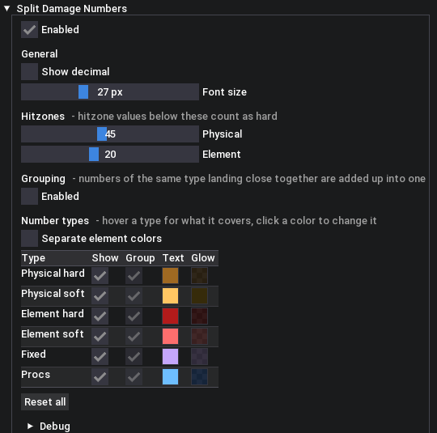
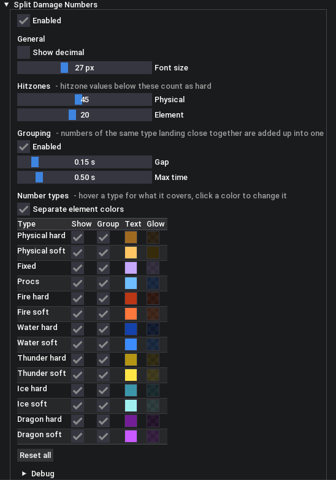

# Split Damage Numbers - Monster Hunter Wilds Mod

<table>
  <tr>
    <td valign="top" width="50%">
      
    </td>
    <td valign="top" width="50%">
      
    </td>
  </tr>
</table>

## Requirements

- Requires [REFramework](https://www.nexusmods.com/monsterhunterwilds/mods/93)

## Features

- Colors damage numbers by what caused them:
  - **Physical hard / soft**: physical damage on hitzones below / at or above a configurable limit (default 45)
  - **Element hard / soft**: element damage on hitzones below / at or above a configurable limit (default 20)
  - **Fixed**: damage that ignores hitzones, e.g. gunlance shells, hunting horn bubble procs, ...
  - **Procs**: extra hits from skills and status procs, e.g. White Flame Torrent, Scorcher, blast procs, ...
- Shows the physical and element part of a hit as two separate numbers
- Optional grouping: numbers of the same type that land close together are added up into one
- Configurable text and glow color, visibility and grouping per number type
- Configurable font size and optional decimal places

## Installation

- Download from GitHub Releases and ensure `split_damage_numbers.lua` is placed under `reframework/autorun`

## Usage

- After installation, open the REFramework menu and configure the mod under `Split Damage Numbers`
- Settings are saved automatically to `reframework/data/split_damage_numbers.json`

## Default Colors

- **Physical**: Default game color
- **Element**: Red
- **Fixed**: Purple
- **Proc**: Blue

